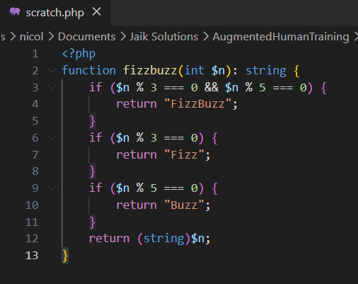

# Lab 0 submission

## Copilot suggestion screenshot

## What the app does

LinkKeeper is a small Laravel 13 bookmark manager. Users can list, add, and pin/unpin bookmarks (each has a title, URL, optional `visited_at`, and a `pinned` flag) through the `/bookmarks` page, and there is a `/health` JSON endpoint. Routes are defined in `routes/web.php`, the logic lives in `app/Http/Controllers/BookmarkController.php`, and the data model is `app/Models/Bookmark.php`, with migrations and seeders (30 sample bookmarks) under `database/`.

## Oddity found

The `Bookmark` docblock claims `visited_at` is never null, but the migration makes it nullable, the seeder creates 3 bookmarks with `visited_at` null, and the view handles the null case.
